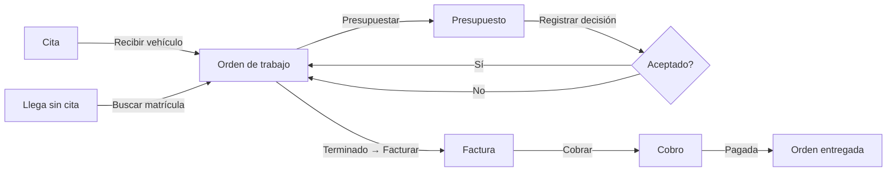

# UX

Navegación, flujos y patrones de pantalla de Gonzalvo. Qué hace cada módulo está en `REQUIREMENTS.md`; aquí se define cómo se usa.

## 1. Principios

1. **La matrícula es la puerta de entrada.** En un taller se busca por matrícula antes que por cliente. Aparece grande en toda pantalla de vehículo, orden, presupuesto o factura.
2. **Una acción principal por pantalla,** siempre en el mismo sitio (arriba a la derecha) y con el mismo color.
3. **Dos niveles como máximo:** listado → ficha. Las altas rápidas se abren en un panel lateral, sin salir de la pantalla.
4. **El estado se ve de lejos:** cada estado tiene un color fijo en toda la aplicación.
5. **Se avanza desde el propio documento.** De una cita se recibe el vehículo, de una orden se presupuesta o se factura, y de una factura se cobra. No hace falta ir al menú.
6. **Teclado:** ⌘K abre la búsqueda global y Esc cierra paneles.

## 2. Estructura

```
┌───────────────┬───────────────────────────────────────────────────┐
│ GONZALVO      │ [⌘K Buscar matrícula, cliente, teléfono, nº…] [+ Nuevo ▾] │
│               ├───────────────────────────────────────────────────┤
│ Inicio        │                                                   │
│ Agenda        │                                                   │
│ Órdenes       │                 Contenido                         │
│ ───────────── │                                                   │
│ Presupuestos  │                                                   │
│ Facturas      │                                                   │
│ Cobros        │                                                   │
│ ───────────── │                                                   │
│ Clientes      │                                                   │
│ Vehículos     │                                                   │
│ Catálogo      │                                                   │
│               │                                                   │
│ Configuración │                                                   │
│ [Usuario ▾]   │                                                   │
└───────────────┴───────────────────────────────────────────────────┘
```

**Menú lateral fijo** en tres grupos, sin títulos:
- Día a día: Inicio, Agenda, Órdenes.
- Ventas: Presupuestos, Facturas, Cobros.
- Datos: Clientes, Vehículos, Catálogo.

**Barra superior:**
- **Búsqueda global:** encuentra matrículas, clientes, teléfonos, NIF y números de documento.
- **Botón «+ Nuevo»:** Orden, Cita, Presupuesto y Cliente con vehículo.

En DEMO y PREVIEW, una franja de color con la marca del entorno ocupa todo el ancho (RF-DEM-07).

## 3. Usuarios y roles

**Uso real:** el titular del taller hace todo (recepción, mecánica, facturación) con una única cuenta de Administrador y lo ve todo, importes incluidos (D-026). **El diseño se optimiza para esa persona:** ninguna pantalla se divide entre «lo de recepción» y «lo del mecánico».

Los roles Recepción y Mecánico quedan preparados para cuando haya empleados. Sus permisos iniciales son ajustables por el administrador (RF-USR-03):

| Sección | Administrador | Recepción | Mecánico |
|---|---|---|---|
| Inicio | Completo | Completo | Completo |
| Agenda | Edita | Edita | Consulta |
| Órdenes | Edita | Edita | Edita estado, trabajos, materiales y notas |
| Presupuestos | Edita | Edita | Consulta |
| Facturas | Edita y emite | Edita y emite | Consulta |
| Cobros | Registra y devuelve | Registra | Consulta |
| Clientes | Edita | Edita | Consulta |
| Vehículos | Edita | Edita | Consulta e historial |
| Catálogo | Edita | Consulta | Consulta |
| Configuración | Completo | — | — |

Todos los roles ven importes y precios. Ocultarlos a un rol concreto es un ajuste de permisos posterior, no una variante de cada pantalla.

## 4. Patrones de pantalla

**Listado**
- Pestañas por estado (`Pendientes · En reparación · Terminadas · Todas`), con contador.
- Búsqueda dentro del listado y tabla con las columnas justas.
- Un clic en la fila abre la ficha.

**Ficha**
- **Cabecera:** número, matrícula, cliente, estado como selector y acciones (la principal destacada, el resto en «⋯»).
- **Pestañas:** el contenido.
- **Columna derecha:** documentos enlazados (cita, presupuestos, facturas).

**Panel lateral**
- Altas y ediciones cortas: cliente con vehículo, cita, cobro y decisión del presupuesto.
- Guardar devuelve a la pantalla de origen con el dato ya seleccionado.

**Líneas de documento** (presupuesto, orden y factura)
- Una tabla editable con buscador de catálogo en la primera celda.
- Se pueden escribir líneas libres.
- Los totales están siempre visibles abajo.

### Ficha de orden de trabajo (pantalla central del taller)

```
┌──────────────────────────────────────────────────────────────────┐
│ OT-2026-0142   [ 1234 KLM ]  Seat León · Marta Ruiz · 600 000 000│
│ Estado: [En reparación ▾]   Mecánico: [Jordi ▾]  [Presupuestar] [Facturar] ⋯ │
├──────────────────────────────────────────┬───────────────────────┤
│ Recepción · Trabajos y materiales ·      │ Cita 04/11 09:00      │
│ Adjuntos · Historial                     │ Presupuesto P-0098 v2 │
│                                          │   ✓ Aceptado 05/11    │
│                                          │ Factura —             │
└──────────────────────────────────────────┴───────────────────────┘
```

Un usuario sin permiso para presupuestar o facturar ve la misma ficha sin esos botones.

## 5. Flujos principales



| # | Flujo | Pasos | Objetivo |
|---|---|---|---|
| F1 | **Llega un coche sin cita** | ⌘K matrícula → ficha del vehículo → «Nueva orden» (cliente y kilometraje precargados) → recepción → Guardar. Si la matrícula no existe: «Crear cliente y vehículo» en panel lateral y se sigue igual | ≤ 4 clics si ya existe |
| F2 | **Llega un coche con cita** | Inicio o Agenda → cita → «Recibir vehículo» → recepción → Guardar. La cita pasa a Atendida | ≤ 3 clics |
| F3 | **Recepción** | Pestaña de la orden: kilometraje, combustible, checklist, daños, fotos (desde el Mac o subidas) → opcional «Imprimir resguardo» | Un único formulario |
| F4 | **Presupuestar y autorizar** | Orden → «Presupuestar» (precarga los trabajos de la orden) → líneas → «Enviar por email» o «Imprimir» → «Registrar decisión»: aceptado/rechazado, método (papel firmado adjunto o conformidad con nota). Al aceptar, se ofrece pasar la orden a En reparación | Sin salir de la orden |
| F5 | **Cambio tras aceptar** | Editar un presupuesto aceptado → aviso «Se creará la versión 2 y necesitará nueva autorización» → la v1 queda Sustituida | Imposible modificar sin querer |
| F6 | **Trabajo en la orden** | Inicio (órdenes en curso) → orden → añadir trabajos, materiales y notas → estado Terminado | Los importes se actualizan solos |
| F7 | **Facturar y cobrar en la entrega** | Orden Terminado → «Facturar» → borrador con líneas de la orden y del presupuesto aceptado → revisar → «Emitir» → «Cobrar» (importe total precargado; editable para pago parcial) → justificante → la orden pasa a Entregado | ≤ 5 clics |
| F8 | **Cobro posterior** | Inicio (pendientes de cobro) o Facturas → factura → «Cobrar» | — |
| F9 | **Corregir una factura** | Factura emitida → ⋯ «Rectificar» → total o por diferencias → emitir rectificativa. La original no cambia | — |
| F10 | **Presupuesto rápido sin cliente** | «+ Nuevo» → Presupuesto → Cliente ocasional → líneas → imprimir | Sin dar de alta a nadie |

**En TALLER, hasta la validación fiscal** (D-014), «Emitir» aparece desactivado con el texto «La facturación se activará cuando esté validada. Factura en Stall». Los flujos F7 a F9 solo se prueban en la demo.

## 6. Estados y colores

Un color por significado, igual en todos los módulos (la paleta definitiva se fija en el sistema visual):

| Significado | Estados |
|---|---|
| Neutro, por empezar | Pendiente (orden, presupuesto, cita) |
| En curso | En reparación, Confirmada, Parcialmente pagada |
| Espera externa | Esperando recambios |
| Listo | Terminado, Aceptado, Pagada, Atendida |
| Cerrado | Entregado, Sustituido, Caducado |
| Negativo | Cancelado, Rechazado |

## 7. Pendiente en la Fase 3

1. Aprobación de esta navegación y de estos flujos.
2. Sistema visual: tipografía, paleta, componentes y logotipo de Gonzalvo.
3. Prototipos de las pantallas clave: Inicio, Órdenes (listado y ficha), Presupuesto, Factura con cobro y Agenda.
4. Validación de los prototipos con el taller.
